<picture>
  <source media="(prefers-color-scheme: dark)" srcset=".github/assets/header-dunkel.svg">
  
</picture>

# Wellux Starred Repos

Every AI repo Wellux has starred on GitHub, 3,533 of them, sorted into nine groups and 70 categories. Each repo has exactly one home, filed by the job it does. Every group is its own awesome list; this page is the map, with the **AI OS Rating**: how much a category matters when you build a personal AI operating system like myOS.

<picture>
  <source media="(prefers-color-scheme: dark)" srcset=".github/assets/overview-dunkel.svg">
  
</picture>

<!-- onboarding:start -->
### In 3 Minuten startklar

<picture>
  <source media="(prefers-color-scheme: dark)" srcset=".github/assets/onboarding-dunkel.svg">
  
</picture>

1. **Karte.** Oben die Karte: neun Gruppen mit Zahl der Repos und dem AI OS Rating, jede Gruppe ist eine eigene Awesome-Liste.
2. **Rating.** Unter [Every category](#every-category) steht für jede Kategorie, wie wichtig sie für ein persönliches AI OS ist, mit einem Satz Begründung.
3. **Liste öffnen.** Die Gruppe anklicken, die zu deiner Lücke passt; dort steht jedes Repo genau einmal, nach seiner Aufgabe.
4. **Dranbleiben.** Watch auf das Repo setzen: neue Sterne landen automatisch in der richtigen Kategorie.

**Was du davon hast**

- Ein Überblick statt über 3.500 Tabs: jede Kategorie mit Zahl und Gewicht.
- Eine Begründung je Rating, damit du siehst, warum etwas für ein AI OS zählt.
- Neun Listen, die sich gegenseitig verlinken, ohne Dopplungen.

**Nächster Schritt:** Alle Listen einzeln auf [github.com/Wellux](https://github.com/Wellux?tab=repositories&q=awesome); Vorschläge über CONTRIBUTING.md der jeweiligen Liste.
<!-- onboarding:end -->

## The lists

| List | Repos | Stars combined | AI OS Rating | Why |
|:--|--:|--:|:--|:--|
| [Awesome Coding Agents](https://github.com/Wellux/awesome-coding-agents) | 511 | 5.9M | ■■■■■ Core | Claude Code and Codex build and run myOS every day. |
| [Awesome Agent OS](https://github.com/Wellux/awesome-agent-os) | 474 | 3.6M | ■■■■■ Core | The center of an AI OS: agents that live with you and a place to steer them. |
| [Awesome Agent Memory](https://github.com/Wellux/awesome-agent-memory) | 312 | 3.1M | ■■■■■ Core | Context is all you need: memory turns a chat bot into an operating system. |
| [Awesome MCP Connectors](https://github.com/Wellux/awesome-mcp-connectors) | 263 | 2.3M | ■■■■■ Core | Agents need hands: MCP connects them to mail, files, apps and the screen. |
| [Awesome Agent Skills](https://github.com/Wellux/awesome-agent-skills) | 237 | 3.8M | ■■■■■ Core | One SKILL.md that runs in three agents is how myOS shares know-how. |
| [Awesome Agent Engineering](https://github.com/Wellux/awesome-agent-engineering) | 420 | 4.4M | ■■■■□ Strong | Building blocks and safety for agents that act on their own. |
| [Awesome AI Models](https://github.com/Wellux/awesome-ai-models) | 625 | 5.1M | ■■■□□ Useful | Models are the engine, but myOS stays model-agnostic and routes by task. |
| [Awesome AI Creator Stack](https://github.com/Wellux/awesome-ai-creator-stack) | 474 | 4.8M | ■■■□□ Useful | The content engine of Wellux: video, voice and design from the same OS. |
| [Awesome AI at Work](https://github.com/Wellux/awesome-ai-at-work) | 217 | 2.0M | ■■□□□ Niche | Applications on top of an AI OS, chosen per user and job. |

## Every category

<picture>
  <source media="(prefers-color-scheme: dark)" srcset=".github/assets/rating-dunkel.svg">
  
</picture>

### [Awesome Agent OS](https://github.com/Wellux/awesome-agent-os)

The center of an AI OS: agents that live with you and a place to steer them.

| Category | Repos | Rating | Why |
|:--|--:|:-:|:--|
| Personal agents | 106 | 5 | The always-on assistant is the face of an AI OS. |
| Hermes Agent | 45 | 5 | myOS runs Hermes on the Mac mini for Telegram and WhatsApp. |
| Cockpits and control planes | 41 | 5 | Seeing and stopping agents in one place is a myOS promise. |
| Agent and company OS | 59 | 4 | Patterns for many agents with roles, budgets and approvals. |
| OpenClaw | 48 | 4 | Large ecosystem of channels and skills, worth reusing. |
| Chat clients and add-ons | 41 | 3 | Good for reaching any model, the cockpit already covers daily use. |
| Home, body and devices | 40 | 3 | Watch, phone and home extend the OS beyond the screen. |
| DeepSeek Harness | 94 | 2 | Interesting plugin model, not part of the myOS stack. |

### [Awesome Coding Agents](https://github.com/Wellux/awesome-coding-agents)

Claude Code and Codex build and run myOS every day.

| Category | Repos | Rating | Why |
|:--|--:|:-:|:--|
| Coding agents | 73 | 5 | Claude Code and Codex are the crew of myOS. |
| Setups and mods | 61 | 5 | Hooks, mods and status lines are how the cockpit is built. |
| Review, tests and provenance | 46 | 5 | Nothing merges unchecked: tests, review and provenance. |
| Parallel agents | 81 | 4 | Parallel sessions are daily reality, tracking them matters. |
| Specs, loops and factories | 67 | 4 | Spec, loop and verify turns agents into a pipeline. |
| Accounts and usage | 28 | 4 | Plan limits and cost decide what agents may do. |
| Code context | 67 | 3 | Helps on large codebases, myOS repos stay small. |
| Guides and lists | 36 | 3 | Good for learning, less for running the system. |
| Pi and Herdr | 52 | 2 | Pi and Herdr are alternatives to watch, not in use. |

### [Awesome Agent Skills](https://github.com/Wellux/awesome-agent-skills)

One SKILL.md that runs in three agents is how myOS shares know-how.

| Category | Repos | Rating | Why |
|:--|--:|:-:|:--|
| Skill tooling | 35 | 5 | Make, test and sync skills across Claude Code, Codex and Hermes. |
| Rules and context | 23 | 5 | CLAUDE.md and AGENTS.md carry the same rules for every agent. |
| Skill libraries | 73 | 4 | Proven skills to adopt before writing new ones. |
| Prompts and system prompts | 48 | 4 | System prompts are the cheapest lever on quality. |
| Skills for software work | 43 | 3 | Useful for software work, myOS needs few of them. |
| Subagents and roles | 15 | 3 | Ready-made roles, myOS keeps its own small set. |

### [Awesome MCP Connectors](https://github.com/Wellux/awesome-mcp-connectors)

Agents need hands: MCP connects them to mail, files, apps and the screen.

| Category | Repos | Rating | Why |
|:--|--:|:-:|:--|
| MCP servers | 74 | 5 | Every app the user lives in should be one server away. |
| MCP foundations | 44 | 5 | myOS exposes Agent OS and the vault as MCP servers. |
| Browser agents | 41 | 4 | The web is where most tasks start. |
| Computer and phone use | 37 | 4 | When there is no API, CUA drives the Mac. |
| Connectors and agent CLIs | 20 | 4 | Many apps behind one door save setup time. |
| Workflow pipes | 18 | 4 | Deterministic workflows first, agents only for thinking. |
| Web data for LLMs | 29 | 3 | Clean web context helps research jobs. |

### [Awesome Agent Memory](https://github.com/Wellux/awesome-agent-memory)

Context is all you need: memory turns a chat bot into an operating system.

| Category | Repos | Rating | Why |
|:--|--:|:-:|:--|
| Second brain and LLM wikis | 62 | 5 | The Obsidian vault is the shared brain of myOS. |
| Agent memory | 56 | 5 | Memory that survives the next session is the core of myOS. |
| Vector search and embeddings | 64 | 4 | Embeddings and full-text search sit under every lookup. |
| Documents and capture | 31 | 4 | PDFs, mails and screens must become notes. |
| RAG | 72 | 3 | Useful for large document sets, the vault search covers most needs. |
| Research agents | 27 | 3 | Deep research runs on demand, not every day. |

### [Awesome Agent Engineering](https://github.com/Wellux/awesome-agent-engineering)

Building blocks and safety for agents that act on their own.

| Category | Repos | Rating | Why |
|:--|--:|:-:|:--|
| Sandboxes, guardrails and evals | 117 | 5 | Kill switch, sandbox and evals come before autonomy. |
| Self-improving and reasoning | 29 | 4 | The night shift lets agents improve their own playbook. |
| Voice and realtime agents | 29 | 4 | Voice notes and calls are how the user talks to Hermes. |
| Workflow automation | 27 | 4 | n8n-style pipes for the routine. |
| Learn agent engineering | 75 | 3 | Courses and maps of the field. |
| Agent frameworks and SDKs | 72 | 3 | myOS builds on harnesses, not on a framework. |
| Autonomous and multi-agent | 49 | 3 | Multi-agent ideas, used carefully and with approvals. |
| Agent UI, outputs and prompts | 22 | 3 | Typed outputs and agent UIs help the cockpit. |

### [Awesome AI Models](https://github.com/Wellux/awesome-ai-models)

Models are the engine, but myOS stays model-agnostic and routes by task.

| Category | Repos | Rating | Why |
|:--|--:|:-:|:--|
| Gateways and routing | 34 | 5 | One endpoint with budgets and routing, OpenRouter today. |
| Local inference | 69 | 4 | Local models keep private data at home. |
| System One decision models | 32 | 4 | Fast typed decisions for routing and checks. |
| Open models | 46 | 3 | Good to know, chosen per task. |
| SDKs and ML frameworks | 45 | 3 | API clients and CLIs for scripts. |
| Computer vision | 132 | 2 | Specialist models, rarely needed. |
| Machine learning foundations | 87 | 2 | Background knowledge. |
| Training and fine-tuning | 46 | 2 | Fine-tuning is rarely worth it for a personal OS. |
| Video understanding | 45 | 2 | Useful for content review, not daily. |
| Serving and efficiency | 25 | 2 | Cluster serving is beyond a home AI OS. |
| 3D and spatial AI | 42 | 1 | 3D scene models are outside the AI OS core. |
| Robotics and driving | 22 | 1 | Physical AI is a different field. |

### [Awesome AI Creator Stack](https://github.com/Wellux/awesome-ai-creator-stack)

The content engine of Wellux: video, voice and design from the same OS.

| Category | Repos | Rating | Why |
|:--|--:|:-:|:--|
| Voice and audio | 88 | 4 | Voice clone and transcription feed videos and voice notes. |
| Design and UI | 65 | 4 | Interfaces with taste for cockpit and sites. |
| Motion as code | 42 | 4 | Motion as code is how Wellux draws its scenes. |
| Video | 106 | 3 | Weekly videos from the upgrade log. |
| Images | 91 | 3 | Thumbnails and visuals. |
| Slides, documents and artifacts | 22 | 3 | Decks and docs an agent can ship. |
| Writing | 16 | 3 | Words that sound like the user. |
| 3D and AI CAD | 44 | 1 | Outside the AI OS core. |

### [Awesome AI at Work](https://github.com/Wellux/awesome-ai-at-work)

Applications on top of an AI OS, chosen per user and job.

| Category | Repos | Rating | Why |
|:--|--:|:-:|:--|
| Marketing and growth | 56 | 3 | Content, SEO and ads for Wellux. |
| Research and monitoring | 33 | 3 | Monitoring news and markets for the morning brief. |
| Office, documents and data | 33 | 3 | Docs, sheets and dashboards done by agents. |
| Finance and trading | 55 | 2 | Personal finance stays local and private. |
| Careers and education | 24 | 2 | Careers and learning, occasional. |
| Industries | 16 | 2 | Industry tools, picked per client. |

## How the rating works

- **5 Core:** used every day in a personal AI OS. **4 Strong:** you will want it soon. **3 Useful:** pick per need. **2 Niche:** good to know. **1 Elsewhere:** great repos, other field.
- The rating judges the category for an AI OS, not the quality of single repos.
- Only public repos with a home in the atlas count; archived repos are left out, as in the lists.

Updated 2026-11-16 from the Wellux star atlas. License: CC0.
